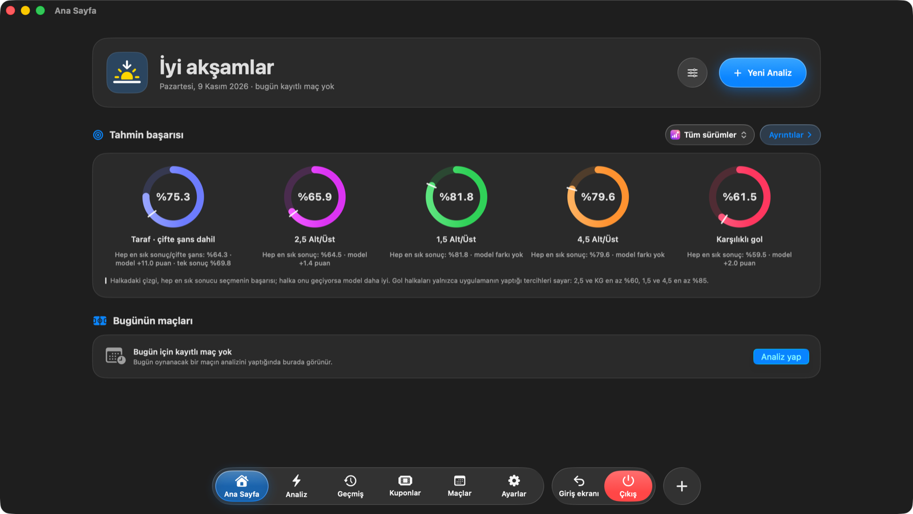
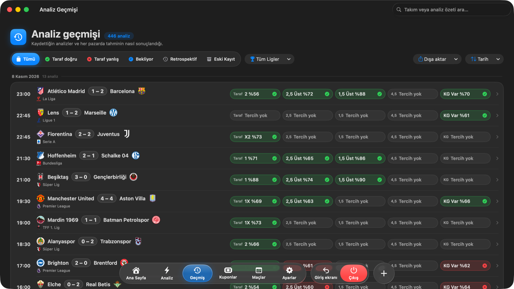
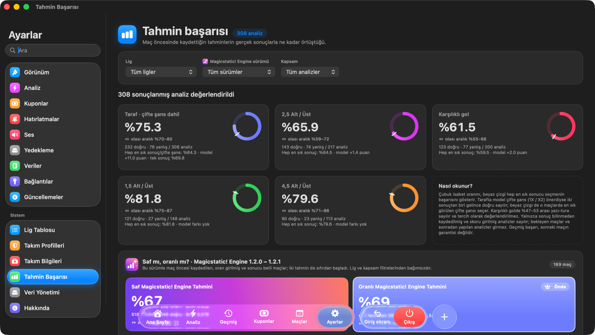
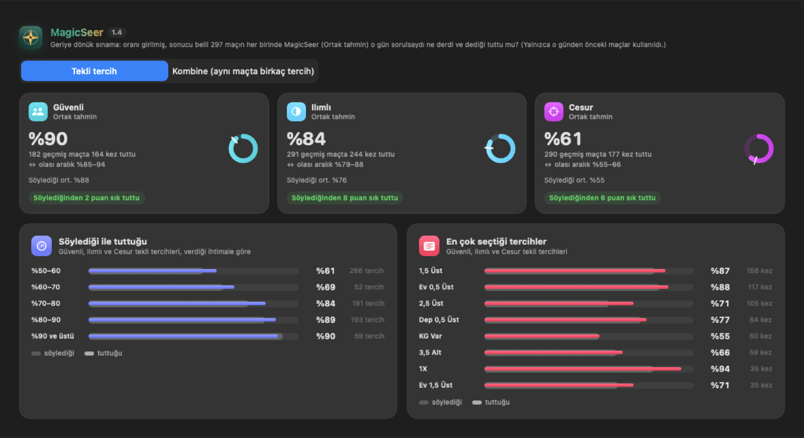

  

<h1 align="center">E-T Analysis</h1>

  Mac için futbol maç analizi: maç öncesi tahminler, kupon önerileri ve tahminlerin sonradan nasıl tuttuğunun dürüst takibi.

  <a href="https://github.com/cokomayi/etanalysis-app/releases/latest"><b>⬇︎ Son sürümü indir</b></a>

---

## Neler yapar?

- **Maç analizi** – Takımların formu, iç saha / deplasman performansı, eksik oyuncular ve bahis oranlarını bir araya getirip taraf (1 / X / 2, çifte şans), 1,5 · 2,5 · 4,5 Alt/Üst ve karşılıklı gol için ihtimal verir. Emin olmadığı pazarda “Tercih yok” der.
- **MagicSeer** – Günün maçlarından Güvenli, Ilımlı ve Cesur kupon önerileri hazırlar. Maç sayısını sen seçebilir ya da ona bırakabilirsin; istersen canlı maçları da katar.
- **Keskin değer** – Bahis sitesindeki oranı keskin piyasa oranıyla karşılaştırır, hangi tercihin değerli hangisinin pahalı olduğunu renkle gösterir.
- **Analiz geçmişi** – Kaydettiğin her analizin her pazarda tutup tutmadığını gösterir; lige ve sonuca göre süzülür, dışa aktarılır.
- **Tahmin başarısı** – Uygulamanın gerçekte ne kadar isabetli olduğunu, olası aralığıyla birlikte ve “hep en sık sonucu seçmek” ile karşılaştırarak gösterir. Rakamlar süslenmez.
- **Kuponlar** – Kuponlarını kaydet, sonuçlarını otomatik getir; kazanan, kaybeden ve bozdurulan kuponlar ayrı renklerle görünür.
- **Otomatik güncelleme** – Ayarlar › Güncellemeler yeni sürümü bulur, imzasını doğrular ve kurar.

## Ekran görüntüleri

| Analiz geçmişi | Tahmin başarısı |
| --- | --- |
|  |  |

   
  MagicSeer’ın geçmiş maçlarda söylediği ile tuttuğu

## Kurulum

**Gerekenler:** Apple çipli (M1 ve sonrası) bir Mac ve macOS 26.

1. [Releases](https://github.com/cokomayi/etanalysis-app/releases/latest) sayfasından **ET-Analysis.zip** dosyasını indir.
2. Dosyaya çift tıkla; çıkan **E-T Analysis** uygulamasını **Uygulamalar** klasörüne sürükle.
3. İlk açılışta macOS “geliştirici doğrulanamadı” uyarısı verir. **Sistem Ayarları › Gizlilik ve Güvenlik**’e gidip en altta **Yine de Aç**’a tıkla. Bu yalnızca bir kez gerekir.
4. Uygulama boş bir veritabanıyla açılır. **Ayarlar › Veriler**’den **Verileri denetle** ile maç verilerini getir.
5. Bahis oranlarının otomatik gelmesi için [The Odds API](https://the-odds-api.com)’den ücretsiz bir anahtar al ve **Ayarlar › Bağlantılar**’a yapıştır. (İsteğe bağlı; oranları elle de girebilirsin.)

Sonraki sürümler için tekrar indirmene gerek yok: **Ayarlar › Güncellemeler › Güncellemeleri denetle**.

## Sorumlu kullanım

- Bu uygulama **18 yaş ve üzeri** içindir.
- Tahminler istatistiktir, **kesinlik değildir**. Yüksek bir ihtimal bile tutmayabilir; bahis para kaybettirebilir.
- Uygulama **bahis oynamaz**, para almaz veya göndermez; hiçbir bahis sitesiyle bağlantısı yoktur. iddaa, Pinnacle ve diğer adlar yalnızca oran kaynağı olarak anılır, bu kuruluşlarla bir ilişkisi yoktur.
- Türkiye’de yalnızca yasal yollardan bahis oynanabilir.
- Kumar bir sorun hâline geldiyse yalnız değilsin: **Yeşilay Danışmanlık Merkezi – 115** (ücretsiz).

---

© 2026 E-T Analysis · Kaynak kodu bu depoda yer almaz; burada yalnızca imzalı sürümler yayınlanır.

